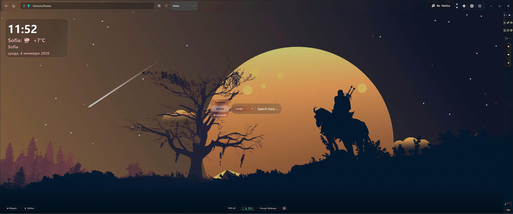
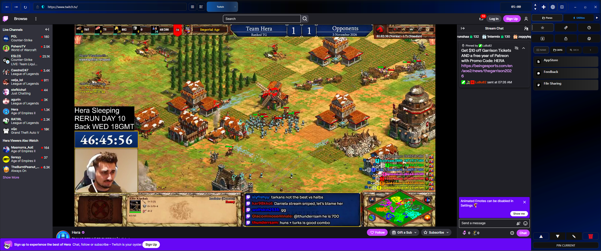
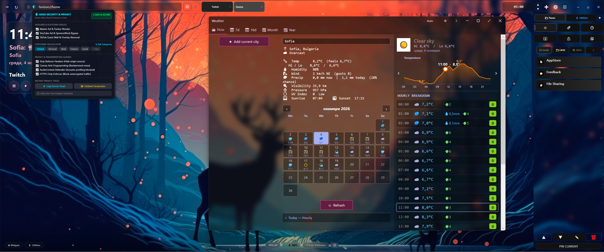
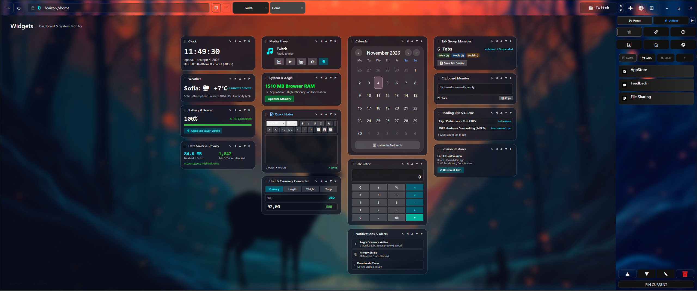
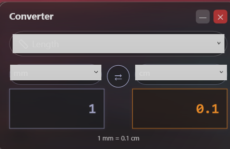
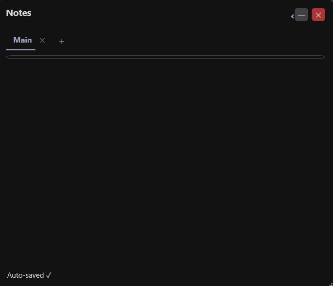
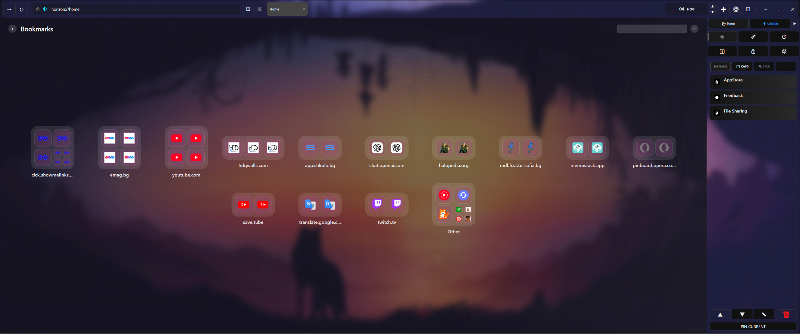
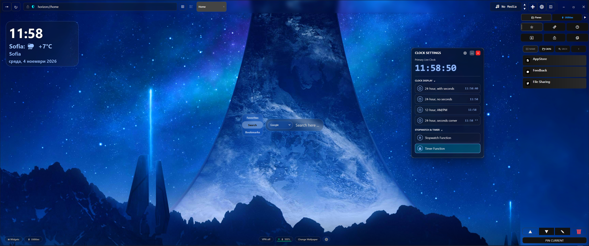
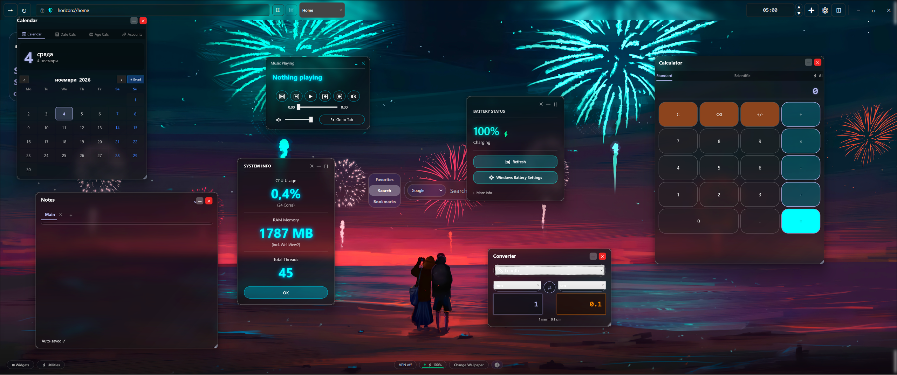
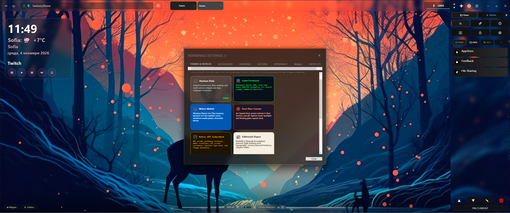

# Horizon Browser

A Windows desktop browser built on WPF and WebView2, with a small Rust library for the performance-sensitive parts. I started it because I got frustrated over the years with many small but numerous compromises that define a standard modern web browser, with the recent introduction of multiple logins to the same site without juggling incognito windows being an example of a feature i always wished to have in my browsing experience. Everything started with making the header and sidebar truly adaptable & powerful tools, and the project grew from there.

[](docs/version.txt)
[](#install)

<a href="docs/screenshots/01-homepage-hero.png">
  
</a>

## What it is

Horizon is a Chromium-based browser (through Microsoft's WebView2) with a custom WPF shell. Most of what makes it different is in the shell:

- Container tabs, so you can stay logged into several accounts on the same site at once
- A tab governor that puts background tabs to sleep in stages to save memory
- A homepage with a widget board, bookmarks view and a sidebar
- Built-in tracker blocking and a few site-specific fixes

## Features

### Homepage

The homepage has a blurred acrylic background with the search bar fixed in the middle of the screen. It stays put when you open favorites or switch to widgets. Around it:

- A draggable status capsule at the top (the "Dynamic Island") showing current media, tab state and a few shortcuts. It collapses when you click outside it.
- Weather and a clock.
- A dock at the bottom with a VPN bypass toggle, battery status, wallpaper switcher and quick settings.

<a href="docs/screenshots/06-active-browsing-dynamic-island.png">
  
</a>

### Container tabs and privacy (Aegis)

Right-click a tab to move it into a container: Work, Personal, Finance, Shopping, or one you name yourself. Each container has its own cookies, localStorage, IndexedDB and HTTP cache (it uses `CoreWebView2Profile` under the hood), so you can be logged into two Google or GitHub accounts side by side. Tabs show a colored badge for their container.

Also included:

- AdGuard-based tracker blocking
- SponsorBlock for YouTube
- Removal of TikTok's guest login popup
- Referrer header stripping

<a href="docs/screenshots/04-aegis-security-containers.png">
  
</a>

### Widget board

The Widgets view fills the window with a grid of cards:

| Widget | What it does |
|---|---|
| World clock | Several timezones, digital or analog |
| Weather | Temperature, humidity, pressure, forecast |
| RAM governor | Memory use of the browser's process tree, read through the Rust library |
| Quick notes | Scratchpad with autosave and word/character counts |
| Converter | Length, weight, temperature and currency |
| Calculator | Scientific calculator |
| Battery | Charge level and power state from Win32 |
| Calendar | Agenda, date difference and age calculators |

<a href="docs/screenshots/02-widget-board.png">
  
</a>

<table>
  <tr>
    <td align="center" width="50%">
      
      <br/>Converter
    </td>
    <td align="center" width="50%">
      
      <br/>Notes
    </td>
  </tr>
</table>

### Bookmarks and favorites

Bookmarks are grouped by domain into cards that pack together to fill the space. Each folder can be shown in one of five ways: header only, first row, stacked preview, mini folder, or full list. Popups open and close with a spring animation.

<a href="docs/screenshots/03-favorites-bookmarks.png">
  
</a>

### Sidebar

The sidebar slides out from the edge and holds:

- Tab categories, panes and workspaces, color-coded
- Recent downloads, with cut, copy, paste and open
- An overlay mode on the homepage, so it floats over the widgets instead of pushing them aside. On regular web pages it pushes the page instead.

<a href="docs/screenshots/05-flux-sidebar.png">
  
</a>

### Calendar

A monthly calendar with events, plus a date calculator (days, weeks and months between two dates) and an age calculator. Available from the homepage and the widget board.

<a href="docs/screenshots/07-calendar-productivity.png">
  
</a>

### Themes

The homepage has nine looks, switchable from settings:

Horizon Flow (default), CyberTerminal HUD, Metro Matrix, Rust Neo-Canvas, Retro CRT Cyberdeck, Editorial Paper, Starship LCARS, Zen Garden, Win95 RetroDesk.

You can also adjust glass opacity, noise, border glow and wallpaper blur.

<a href="docs/screenshots/08-homepage-customizer.png">
  
</a>

## How it's built

Three layers:

```
WPF shell (C#)
  main window, status capsule, homepage, sidebar, widget board

Rust library (horizon_core.dll)
  process-tree memory auditing, wallpaper luminance sampling,
  dock and grid layout math

WebView2 (Chromium)
  container profiles, tab governor, DevTools Protocol capture
  for tab previews, fingerprint and client-hint cleanup
```

### Tab governor

Background tabs move through these states to keep memory down:

1. **Active**: rendering normally, audio and video keep playing.
2. **Warm**: timers and background JavaScript are throttled.
3. **Dormant**: state is cached and memory is trimmed.
4. **Suspended**: DOM is serialized and execution stops until you switch back.
5. **Cryo**: memory is fully released, and the tab is restored from a saved state when you return to it.

## Keyboard shortcuts

| Shortcut | Action |
|---|---|
| <kbd>Ctrl</kbd> + <kbd>T</kbd> | New tab |
| <kbd>Ctrl</kbd> + <kbd>W</kbd> | Close tab |
| <kbd>Ctrl</kbd> + <kbd>Tab</kbd> | Tab switcher with live previews |
| <kbd>Ctrl</kbd> + <kbd>Shift</kbd> + <kbd>Tab</kbd> | Previous tab |
| <kbd>Ctrl</kbd> + <kbd>1</kbd> to <kbd>9</kbd> | Jump to tab 1 to 9 |
| <kbd>Ctrl</kbd> + <kbd>H</kbd> | History |
| <kbd>Ctrl</kbd> + <kbd>J</kbd> | Downloads in the sidebar |
| <kbd>Ctrl</kbd> + <kbd>B</kbd> | Toggle sidebar |
| <kbd>Ctrl</kbd> + <kbd>L</kbd> or <kbd>Alt</kbd> + <kbd>D</kbd> | Focus the address bar |
| <kbd>F11</kbd> | Fullscreen |
| <kbd>Ctrl</kbd> + <kbd>Shift</kbd> + <kbd>I</kbd> | DevTools |
| <kbd>Ctrl</kbd> + <kbd>+</kbd> / <kbd>-</kbd> / <kbd>0</kbd> | Zoom in, out, reset |

## Install

Requires Windows 10 or 11 (64-bit) and the [WebView2 Runtime](https://developer.microsoft.com/en-us/microsoft-edge/webview2/), which comes with Windows 11.

**From a release**

1. Download `Horizon_Browser_official_release.zip` from Releases.
2. Extract it anywhere.
3. Run `Horizon.exe`.

**From source**

You need the [.NET 8 SDK](https://dotnet.microsoft.com/download) and Visual Studio 2022 (or the Windows C++ build tools, for the Rust library).

```powershell
git clone https://github.com/MoRDekai1364/Horizon_Browser.git
cd Horizon_Browser
dotnet build -c Release "Horizon.Browser.csproj"
& "bin\Release\Horizon.Browser.exe"
```

## Roadmap

Done:

- [x] Container tabs and profile isolation
- [x] Widget board
- [x] Sidebar
- [x] Nine homepage themes
- [x] Rust core library
- [x] TikTok login popup and YouTube SponsorBlock fixes
- [x] Chrome Web Store, Edge Add-ons and Firefox extension installer
- [x] Inno Setup installer
- [x] Built-in updater with automatic profile backup and restore
- [x] Command bar (<kbd>Ctrl</kbd> + <kbd>T</kbd>)
- [x] English and Bulgarian interface
- [x] Academic tools: citation builder, DOI resolver, SSL inspector, text miner

In progress:

- [ ] VPN relay: local relay, profiles and control center exist, remaining phases are not finished
- [ ] Side-expand mode for homepage folders
- [ ] More widgets in the homepage stack
- [ ] Split view with two tabs: registered as a command, layout not finished

Planned:

- [ ] Encrypted tab and session sync
- [ ] MSIX package
- [ ] Remaining utilities from the ideas list (ISBN tracker, PDF annotator, WebSocket inspector, header manipulator and others)

## Feedback

- Ideas and bug reports: [feedback portal](https://feedbackcol-nszemvwz.manus.space/)
- Issues: [GitHub](https://github.com/MoRDekai1364/Horizon_Browser/issues)

## License

Custom distribution terms.